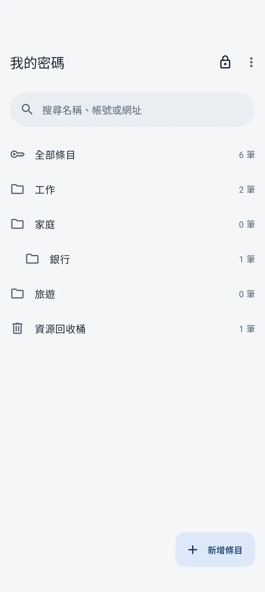
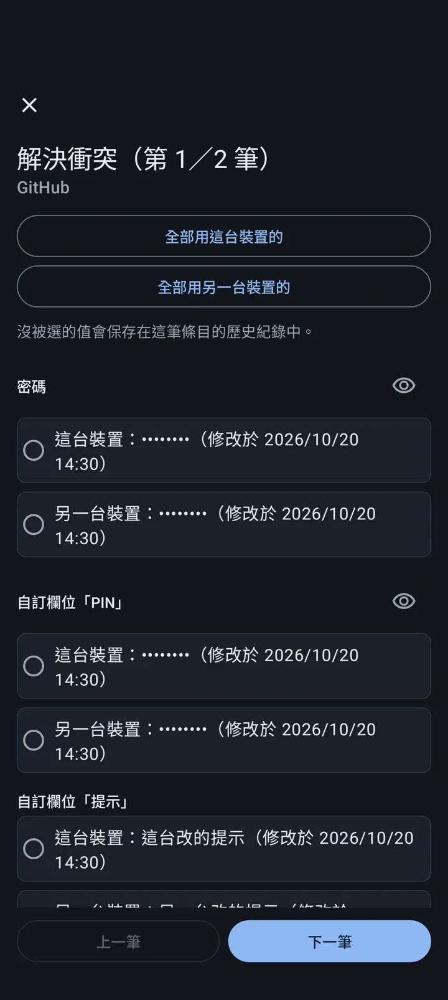
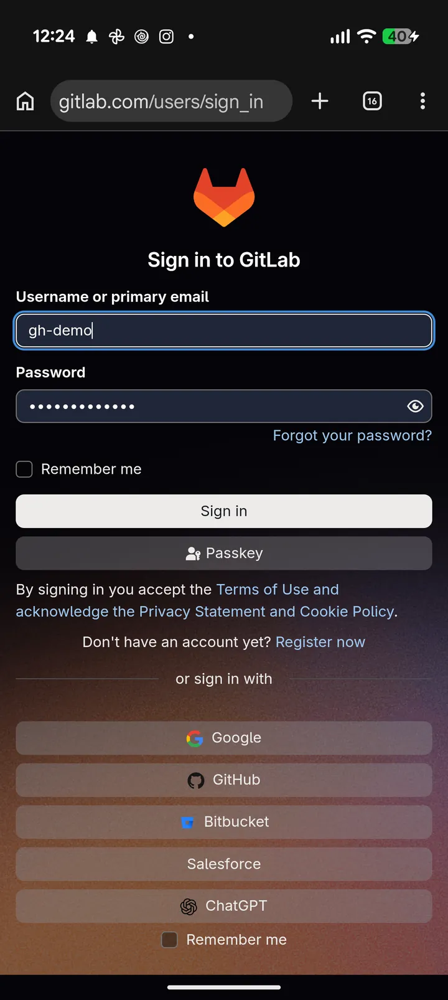
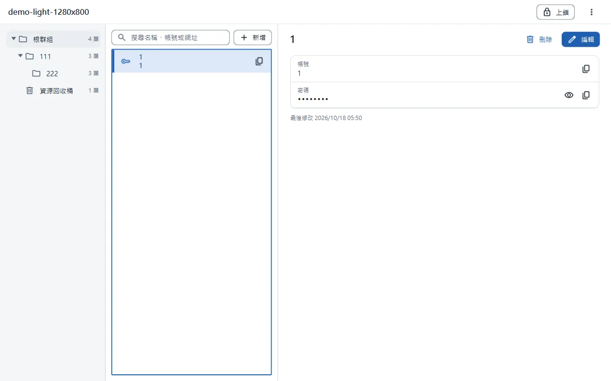

# S-Vault

免費、開源的密碼管理器，給想在 Windows 電腦與 Android 手機上用同一個保管庫的人。保管庫是標準的 KeePass KDBX 4 檔案，放在自己的 Google Drive；兩台裝置各自修改後，存檔時以三方合併把兩邊的修改合在一起，不會互相覆蓋。隨時可以改用 KeePassXC 開同一個檔案，資料不被綁死。

## 功能

| Android 首頁 | 衝突對照（深色） | 自動填入 | Windows 主畫面 |
|---|---|---|---|
|  |  |  |  |

截圖都是假資料。

- **同步不掉資料**：偵測雲端檔案被另一台改過，以上次同步的版本為基準逐欄合併；同一欄位兩邊改得不一樣時，並排列出讓你選，沒選的那一版留在歷史紀錄。
- **安全存檔**：每次存檔前自動備份，寫出後先解開比對內容，確認無誤才取代原檔；存檔中斷不會損壞檔案，可從備份還原。
- **條目與群組**：新增、編輯、搜尋、資源回收桶；KeePassXC 建立的自訂欄位與附件原樣保留。
- **密碼產生器**：隨機密碼與 EFF 字表的通行片語。
- **剪貼簿**：複製密碼後依設定的秒數自動清除，上鎖時立即清除。
- **自動填入（Android）**：依網址或 App 比對條目；只相信簽署憑證驗證過的瀏覽器，http 頁面不提供存成 https 的帳密。
- **生物辨識解鎖（Android）**。
- **自動上鎖與防截圖**：閒置、切到背景、鎖定螢幕時上鎖；Android 與 Windows 解鎖時都擋螢幕截圖（Windows 可在設定關閉）。
- **密碼健檢**：弱密碼、重複使用、外洩檢查（只送密碼 SHA-1 的前 5 碼）。
- **從 Chrome 匯入**：Chrome 匯出的 CSV。

## 支援範圍

- Windows 10（2004 以上）、Windows 11。
- Android 10（API 29）以上。
- 保管庫：KDBX 4，金鑰衍生 Argon2d 或 AES-KDF，加密 AES-256 或 ChaCha20。**不支援** Argon2id、Twofish、KDBX 3.1（開啟時會說明原因，不改動檔案）。
- 同步靠 Google Drive（電腦版的同步資料夾、手機的系統檔案選擇器）；S-Vault 沒有自己的伺服器，除了外洩檢查以外不連網。

## 安裝與使用

到 GitHub Releases 下載：

- **Windows**：`S-Vault-<版本>.exe`。安裝檔沒有程式碼簽章，SmartScreen 會跳警告，按「其他資訊 → 仍要執行」。
- **Android**：`S-Vault-<版本>.apk`。沒有上架 Google Play，安裝前要允許用來傳 APK 的 App「安裝不明應用程式」。

Release 頁附每個檔案的 SHA-256。第一次使用：

1. 在電腦上按「建立新的保管庫」，存到 Google Drive 的同步資料夾，設定主密碼（忘記就無法復原）。
2. 在手機上按「開啟保管庫」，從系統的檔案選擇器選 Google Drive 上同一個檔案，輸入主密碼。
3. 之後在任何一台修改，S-Vault 會在存檔與回到前景時同步。

從原始碼建置需要 JDK 25、Android SDK（compileSdk 37）、PowerShell 7：

```powershell
$env:SVAULT_DATA_DIR = "$PWD\.localdata\data"   # 開發版一定要指定，避免讀寫真正的 %APPDATA%\S-Vault
.\gradlew :desktop:run                           # Windows 開發版
.\gradlew :android:installDebug                  # 裝 debug 版到連線的手機
.\gradlew :core:test :desktop:test :android:testDebugUnitTest
```

## 文件

- [開發日誌（版本內容）](docs/CHANGELOG.md)
- [開源授權聲明](docs/NOTICES.md)

## 限制與授權

- 安裝檔與 APK 沒有正式的程式碼簽章；請只從本專案的 Releases 下載並核對 SHA-256。
- 手機的 Google Drive 可能比電腦晚幾分鐘拿到最新版；兩台同時修改時會在下次同步合併，不會遺失，但可能看到「合併 n 筆」或衝突對照。
- 沒有基準可比時（第一次同步、雲端被整份取代），另一台永久刪除的條目依刪除紀錄的時間判斷，兩台時鐘差很多時可能誤判（會列在合併通知裡，刪掉的可從備份找回）。
- 自動填入只在 Android；Windows 版沒有瀏覽器擴充功能。
- 外洩檢查使用 Have I Been Pwned 的 Pwned Passwords 範圍查詢，只送雜湊前 5 碼，結果不離開裝置。

S-Vault 以 [Apache License 2.0](LICENSE) 授權。使用的開源套件與它們的授權列在 [docs/NOTICES.md](docs/NOTICES.md)。
